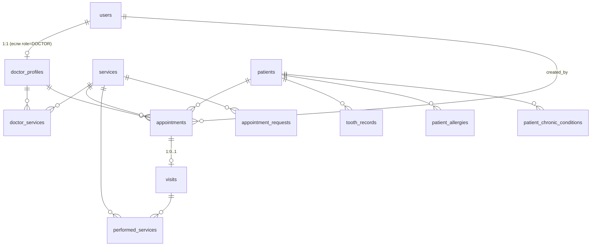

# Структура БД — сайт стоматологической клиники (MVP)

СУБД: PostgreSQL (под Python: SQLAlchemy / Django ORM, неважно). Ниже — таблицы, поля, связи, статусы и несколько правил.

## Что изменено относительно схемы из draw.io / чата

| Было | Стало | Почему |
|---|---|---|
| `User`, `Worker`, `Doctor` — три таблицы с одинаковыми полями (имя, mail, PESEL, phone, ROLE, Salary) | Одна `users` (аккаунт + роль) и `doctor_profiles` (только доктор-специфика) | Дублирование полей. Аккаунт для входа — одна сущность, роль — поле |
| Клиент = `User` | `patients` — отдельно, **только мед. карта**; аккаунт (`users`, role=`PATIENT`) опционально привязан к карте через `patients.user_id` | Запись идёт двумя путями: через рецепцию (карта без аккаунта) и через сайт (пациент с аккаунтом) |
| `Appointment_Summary` | `visits` | Запись (appointment) и сам приём (visit) — разные вещи |
| — | `performed_services` | Что реально сделано, а не что планировалось (для подсчёта выручки) |
| — | `tooth_records` | Зубная карта |
| — | `patient_allergies` | Аллергические реакции — критично для стоматологии (анестетики, латекс, антибиотики) |
| — | `patient_chronic_conditions` | Хронические заболевания (диабет, гипертония, свёртываемость крови и т.д.) |
| — | Хронология визитов | Не отдельная таблица: строится из `appointments` + `visits` + `performed_services` (см. 3.3) |
| `Requests_to_appointment` | `appointment_requests` (необязательно) | Форма для человека без профиля — рецепция перезванивает и создаёт запись |
| Кастомные услуги | Не отдельные услуги, а поля `duration_min` / `buffer_min` прямо в `appointments` | Проще. Врач/рецепция ставит «4ч 28м + 45м буфер» на конкретной записи, справочник не засоряется |
| `Salary` | Убрано | В MVP не нужно |

## Связи (ER)



---

## 1. `users` — аккаунты для входа в систему

Роли: рецепционист, доктор, пациент (регистрируется сам на сайте). Админ — на будущее (создаёт врачей), пока врачей можно заводить скриптом/seed.

| Поле | Тип | Ограничения | Описание |
|---|---|---|---|
| id | bigserial | PK | |
| email | varchar(255) | UNIQUE, NOT NULL | Логин |
| password_hash | varchar(255) | NOT NULL | Только хеш (bcrypt/argon2) |
| first_name | varchar(100) | NOT NULL | |
| last_name | varchar(100) | NOT NULL | |
| phone | varchar(20) | | Строка, не int (плюсы, нули) |
| role | varchar(20) | NOT NULL | `PATIENT`, `RECEPTIONIST`, `DOCTOR`, `ADMIN` |
| is_active | boolean | NOT NULL, default true | Вместо удаления — деактивация |
| created_at | timestamptz | NOT NULL, default now() | |

> Одна роль на пользователя — для MVP достаточно. Если понадобится несколько, вынести в `user_roles`.

## 2. `doctor_profiles` — данные врача

| Поле | Тип | Ограничения | Описание |
|---|---|---|---|
| id | bigserial | PK | |
| user_id | bigint | FK → users.id, UNIQUE, NOT NULL | Пользователь с role=DOCTOR |
| specialization | varchar(100) | | Терапевт, ортодонт, хирург… |
| room | varchar(20) | | Кабинет по умолчанию |

## 3. `patients` — медицинская карта пациента (НЕ аккаунт)

| Поле | Тип | Ограничения | Описание |
|---|---|---|---|
| id | bigserial | PK | |
| first_name | varchar(100) | NOT NULL | |
| last_name | varchar(100) | NOT NULL | |
| pesel | varchar(11) | UNIQUE | **Строкой**: может начинаться с 0, int не подходит. NULL допустим (иностранцы/дети) |
| birth_date | date | | |
| phone | varchar(20) | | |
| email | varchar(255) | | |
| notes | text | | Прочие заметки (аллергии и хронические заболевания — в отдельных таблицах ниже) |
| no_known_allergies | boolean | NOT NULL, default false | Врач/рецепция **явно** подтвердили «аллергий нет». Отличает «нет аллергий» от «ещё не спрашивали» |
| user_id | bigint | FK → users.id, UNIQUE, NULL | Аккаунт пациента. NULL = пациент без аккаунта (записан через рецепцию) |
| is_verified | boolean | NOT NULL, default false | Личность подтверждена рецепцией по документам. Пока `false` — пациент видит только свои записи, но не историю чужой карты |
| created_at | timestamptz | NOT NULL, default now() | |

### Как карта и аккаунт связываются

1. **Регистрация на сайте** → создаётся `users` (role=`PATIENT`) **и сразу новая пустая `patients`** с `user_id` и `is_verified = false`. Пациент может записываться онлайн сразу, при этом чужую медкарту увидеть не может.
2. **Пациент пришёл на приём** → рецепция проверяет документы, дозаполняет карту (PESEL, дата рождения) и ставит `is_verified = true`.
3. **Если у человека уже была карта** (приходил раньше без аккаунта) → рецепция находит старую карту по PESEL, переносит на неё записи из новой карты (`UPDATE appointments SET patient_id = old_id`), ставит `old.user_id = user.id`, `is_verified = true`, а пустую новую карту удаляет. Так никто не может завести аккаунт и самовольно получить чужую медкарту.
4. **Пациент без аккаунта** → рецепция создаёт карту (`user_id = NULL`) как раньше.

### Состав медицинской карты

| Раздел | Где хранится | Кто заполняет |
|---|---|---|
| Основные данные | `patients` | рецепция / пациент (контакты) |
| Аллергические реакции | `patient_allergies` (3.1) | рецепция при первичном опросе, врач |
| Хронические заболевания | `patient_chronic_conditions` (3.2) | рецепция при первичном опросе, врач |
| Хронология визитов | `appointments` + `visits` + `performed_services` (3.3) | формируется автоматически |
| Зубная карта | `tooth_records` (раздел 9) | врач |

### 3.1 `patient_allergies` — аллергические реакции

| Поле | Тип | Ограничения | Описание |
|---|---|---|---|
| id | bigserial | PK | |
| patient_id | bigint | FK → patients.id, NOT NULL | |
| allergen | varchar(150) | NOT NULL | Аллерген: «Лидокаин», «Латекс», «Пенициллин», «Артикаин»… |
| reaction | varchar(255) | | Что происходит: сыпь, отёк, анафилаксия |
| severity | varchar(20) | NOT NULL, default `MODERATE` | `MILD`, `MODERATE`, `SEVERE` |
| notes | text | | |
| created_by | bigint | FK → users.id, NOT NULL | Кто внёс |
| created_at | timestamptz | NOT NULL, default now() | |
| | | UNIQUE (patient_id, allergen) | Без дублей |

Правила:
- пока в карте нет ни одной аллергии **и** `no_known_allergies = false`, врач видит предупреждение «аллергологический анамнез не собран»;
- аллергии со `severity = SEVERE` показываются врачу заметной плашкой в списке записей и в карточке визита;
- удалять запись можно только врачу/рецепции (ошибочный ввод), пациент в MVP видит аллергии, но не правит.

### 3.2 `patient_chronic_conditions` — хронические заболевания

| Поле | Тип | Ограничения | Описание |
|---|---|---|---|
| id | bigserial | PK | |
| patient_id | bigint | FK → patients.id, NOT NULL | |
| name | varchar(150) | NOT NULL | «Сахарный диабет 2 типа», «Гипертония», «Эпилепсия», «Приём антикоагулянтов»… |
| since_year | smallint | | С какого года (если известно) |
| is_active | boolean | NOT NULL, default true | Ремиссия / снято с учёта → `false`, но запись остаётся в истории |
| notes | text | | Препараты, ограничения, рекомендации |
| created_by | bigint | FK → users.id, NOT NULL | |
| created_at | timestamptz | NOT NULL, default now() | |
| | | UNIQUE (patient_id, name) | |

Названия — свободный текст (без справочника МКБ), чтобы не усложнять MVP.

### 3.3 Хронология визитов (история приёмов)

Отдельной таблицы нет — история собирается из существующих. Один визит = одна строка истории; сортировка от новых к старым.

```sql
SELECT
    v.id                 AS visit_id,
    a.start_at           AS date,
    u.last_name || ' ' || u.first_name AS doctor,
    s.name               AS planned_service,
    v.complaints, v.diagnosis, v.summary, v.recommendations,
    COALESCE(
        json_agg(json_build_object(
            'service', ps_s.name,
            'tooth',   ps.tooth_number,
            'qty',     ps.quantity,
            'price',   ps.price
        )) FILTER (WHERE ps.id IS NOT NULL), '[]') AS performed
FROM visits v
JOIN appointments a      ON a.id = v.appointment_id
JOIN doctor_profiles dp  ON dp.id = a.doctor_id
JOIN users u             ON u.id = dp.user_id
JOIN services s          ON s.id = a.service_id
LEFT JOIN performed_services ps ON ps.visit_id = v.id
LEFT JOIN services ps_s  ON ps_s.id = ps.service_id
WHERE a.patient_id = :patient_id
GROUP BY v.id, a.start_at, u.last_name, u.first_name, s.name
ORDER BY a.start_at DESC;
```

Запланированные и отменённые записи (будущие приёмы, `CANCELLED`, `NO_SHOW`) в историю визитов не входят, но их можно показать отдельным блоком «Предстоящие записи» из `appointments`. Индекс: `appointments (patient_id, start_at)` (см. раздел 6).

## 4. `services` — справочник услуг

| Поле | Тип | Ограничения | Описание |
|---|---|---|---|
| id | bigserial | PK | |
| name | varchar(150) | NOT NULL | «Пломба», «Консультация»… |
| description | text | | |
| price | numeric(10,2) | NOT NULL | Базовая цена (деньги — только `numeric`, не float) |
| duration_min | int | NOT NULL | Длительность процедуры по умолчанию |
| buffer_min | int | NOT NULL, default 0 | Буфер после (убраться, подготовить кабинет) |
| is_active | boolean | NOT NULL, default true | Скрыть услугу, не удаляя |

## 5. `doctor_services` — какие услуги оказывает врач (M:N)

| Поле | Тип | Ограничения |
|---|---|---|
| doctor_id | bigint | FK → doctor_profiles.id |
| service_id | bigint | FK → services.id |
| | | PK (doctor_id, service_id) |

Рецепция добавляет строку → врач сразу появляется при записи на эту услугу.

## 6. `appointments` — запись на приём (план)

| Поле | Тип | Ограничения | Описание |
|---|---|---|---|
| id | bigserial | PK | |
| patient_id | bigint | FK → patients.id, NOT NULL | |
| doctor_id | bigint | FK → doctor_profiles.id, NOT NULL | |
| service_id | bigint | FK → services.id, NOT NULL | Плановая услуга |
| start_at | timestamptz | NOT NULL | Начало |
| duration_min | int | NOT NULL | Копируется из услуги, **можно изменить** (кастомная длительность: 268 мин) |
| buffer_min | int | NOT NULL, default 0 | Копируется из услуги, можно изменить |
| end_at | timestamptz | NOT NULL | `start_at + duration_min` |
| blocked_until | timestamptz | NOT NULL | `end_at + buffer_min` — до этого момента слот занят |
| status | varchar(20) | NOT NULL | См. статусы ниже. Рецепция создаёт сразу `SCHEDULED`, сайт — `PENDING` |
| source | varchar(20) | NOT NULL | `RECEPTION` или `WEBSITE` — откуда создана запись |
| room | varchar(20) | | Кабинет |
| comment | text | | Комментарий рецепции (например, из звонка) |
| created_by | bigint | FK → users.id, NOT NULL | Кто создал: рецепционист или сам пациент |
| created_at | timestamptz | NOT NULL, default now() | |
| cancelled_at | timestamptz | | Когда отменена |

**Статусы:**

```
Через сайт:     PENDING ──(рецепция подтверждает)──► SCHEDULED ──► COMPLETED / NO_SHOW
                   └──(рецепция отклоняет)──► CANCELLED
Через рецепцию:                                       SCHEDULED ──► COMPLETED / NO_SHOW
Отмена (пациент или рецепция) из PENDING/SCHEDULED ──► CANCELLED
```

`PENDING` тоже занимает слот (чтобы два человека не записались на одно время), поэтому он входит в ограничение ниже.

**Защита от двойной записи** (на уровне БД, чтобы два рецепциониста не записали одно время):

```sql
CREATE EXTENSION IF NOT EXISTS btree_gist;

ALTER TABLE appointments ADD CONSTRAINT no_doctor_overlap
EXCLUDE USING gist (
    doctor_id WITH =,
    tstzrange(start_at, blocked_until) WITH &&
) WHERE (status IN ('PENDING', 'SCHEDULED'));
```

Отмена пациентом (из личного кабинета) или рецепцией = `status = 'CANCELLED'` — слот освобождается автоматически (условие `WHERE`), запись остаётся в истории.

Индексы: `CREATE INDEX ON appointments (doctor_id, start_at);` и `CREATE INDEX ON appointments (patient_id, start_at);` (второй — для хронологии визитов)

**Правила для записи через сайт (проверяет бэкенд):**
- запись создаёт только пациент с аккаунтом, и только на **свою** карту (`patient_id` берётся из его `users`, а не из запроса);
- пациент отменяет только свои записи;
- `duration_min` / `buffer_min` пациент не меняет — берутся из услуги (кастомное время ставит рецепция/врач);
- длинные/нестандартные процедуры через сайт не записываются, только рецепция.

## 7. `visits` — сам приём (заключение врача)

Создаётся врачом, когда пациент пришёл. Одна запись → максимум один визит.

| Поле | Тип | Ограничения | Описание |
|---|---|---|---|
| id | bigserial | PK | |
| appointment_id | bigint | FK → appointments.id, UNIQUE, NOT NULL | |
| started_at | timestamptz | | Фактическое начало |
| finished_at | timestamptz | | Фактический конец |
| complaints | text | | Жалобы |
| diagnosis | text | | Диагноз |
| summary | text | | Заключение / что было сделано |
| recommendations | text | | Рекомендации пациенту |
| created_at | timestamptz | NOT NULL, default now() | |

При создании визита `appointments.status` → `COMPLETED`.

## 8. `performed_services` — что реально было сделано

Нужна для подсчёта выручки: записался на 1 пломбу, поставили 2 — здесь будет 2.

| Поле | Тип | Ограничения | Описание |
|---|---|---|---|
| id | bigserial | PK | |
| visit_id | bigint | FK → visits.id, NOT NULL | |
| service_id | bigint | FK → services.id, NOT NULL | |
| tooth_number | smallint | | Номер зуба (FDI), если применимо |
| quantity | int | NOT NULL, default 1 | |
| price | numeric(10,2) | NOT NULL | **Цена на момент оказания** (снимок), чтобы смена прайса не меняла старую отчётность |

Выручка за день:

```sql
SELECT SUM(ps.price * ps.quantity)
FROM performed_services ps
JOIN visits v ON v.id = ps.visit_id
WHERE v.finished_at::date = CURRENT_DATE;
```

## 9. `tooth_records` — зубная карта

Нумерация FDI: 11–18, 21–28, 31–38, 41–48 (постоянные), 51–55, 61–65, 71–75, 81–85 (молочные). Текущее состояние зуба пациента — одна строка на зуб.

| Поле | Тип | Ограничения | Описание |
|---|---|---|---|
| id | bigserial | PK | |
| patient_id | bigint | FK → patients.id, NOT NULL | |
| tooth_number | smallint | NOT NULL | Номер по FDI |
| status | varchar(20) | NOT NULL, default `HEALTHY` | `HEALTHY`, `CARIES`, `FILLED`, `CROWN`, `IMPLANT`, `ROOT_CANAL`, `MISSING` |
| notes | text | | |
| updated_by | bigint | FK → users.id | Врач |
| updated_at | timestamptz | NOT NULL, default now() | |
| | | UNIQUE (patient_id, tooth_number) | |

История по зубу восстанавливается из `performed_services.tooth_number` — отдельную таблицу истории делать не нужно.

## 10. `appointment_requests` — заявки с сайта (необязательно для MVP)

Для человека **без аккаунта**: заполняет форму → рецепция звонит → создаёт обычную `appointment` (source=`RECEPTION`). Для пациентов с аккаунтом не используется — они записываются напрямую (`PENDING`).

| Поле | Тип | Ограничения | Описание |
|---|---|---|---|
| id | bigserial | PK | |
| first_name | varchar(100) | NOT NULL | |
| last_name | varchar(100) | NOT NULL | |
| phone | varchar(20) | NOT NULL | |
| email | varchar(255) | | |
| service_id | bigint | FK → services.id | |
| preferred_date | date | | Желаемая дата |
| description | text | | |
| status | varchar(20) | NOT NULL, default `NEW` | `NEW`, `PROCESSED`, `REJECTED` |
| appointment_id | bigint | FK → appointments.id, NULL | Ссылка на созданную запись |
| created_at | timestamptz | NOT NULL, default now() | |

---

## Сценарии → таблицы

| Сценарий | Что происходит в БД |
|---|---|
| Рецепция заводит пациента | INSERT `patients` (`user_id = NULL`) |
| Регистрация на сайте | INSERT `users` (PATIENT) + INSERT `patients` (`user_id`, `is_verified = false`) |
| Запись через рецепцию | Выбор услуги → врачи из `doctor_services` → INSERT `appointments` (`source=RECEPTION`, `status=SCHEDULED`, длительность/буфер можно поправить) |
| Запись через сайт | Пациент выбирает услугу → врача → свободный слот → INSERT `appointments` (`source=WEBSITE`, `status=PENDING`) |
| Рецепция подтверждает онлайн-запись | `status: PENDING → SCHEDULED` (или `CANCELLED` + звонок/письмо) |
| Подтверждение личности | `patients.is_verified = true` (при необходимости — слияние карт, см. раздел 3) |
| Первичный опрос пациента | INSERT `patient_allergies`, `patient_chronic_conditions`; если аллергий нет — `patients.no_known_allergies = true` |
| Врач открывает запись | Видит плашку аллергий (особенно `SEVERE`) и активные хронические заболевания пациента, затем историю визитов |
| История приёмов пациента | Запрос из 3.3 (`visits` + `appointments` + `performed_services`) |
| Длинная операция (4ч 28м) | В `appointments` вручную `duration_min = 268`, `buffer_min = 45` |
| Отмена | `appointments.status = 'CANCELLED'`, `cancelled_at = now()` |
| Врач принял пациента | INSERT `visits` + INSERT `performed_services` + обновление `tooth_records` |
| Выручка за день | Сумма по `performed_services` (см. запрос выше) |
| Добавить врачу услугу | INSERT `doctor_services` |

## Права по ролям (MVP)

| Роль | Доступ |
|---|---|
| `PATIENT` | Создавать `appointments` на себя (`PENDING`), смотреть и отменять только свои; редактировать контактные данные своей карты; видеть свои `visits`, аллергии и хронические заболевания только если `is_verified = true` (только чтение) |
| `RECEPTIONIST` | CRUD `patients`, `appointments` (включая подтверждение `PENDING`), `appointment_requests`; верификация и слияние карт (с переносом аллергий и хронических заболеваний); внесение/правка `patient_allergies` и `patient_chronic_conditions` при первичном опросе; управление `doctor_services`; чтение календаря |
| `DOCTOR` | Свои `appointments` (чтение), CRUD `visits`, `performed_services`, `tooth_records`, `patient_allergies`, `patient_chronic_conditions`; чтение полной истории визитов пациента |
| `ADMIN` (позже) | Создание пользователей/врачей, `services`, аналитика |

## Что осознанно отложено (не MVP)

- Расширенный личный кабинет (просмотр медкарты, зубной карты, документов) — в MVP только запись и отмена
- Автоподтверждение онлайн-записей без рецепции
- Админ-панель для создания врачей (пока seed/скрипт)
- Зарплаты, смены, расписание работы врачей (`doctor_schedules`) — пока рецепция сама видит свободные окна по календарю
- Email/SMS-уведомления
- История изменений зубной карты отдельной таблицей
- Справочник МКБ и справочник аллергенов (пока свободный текст)
- Редактирование аллергий и хронических заболеваний самим пациентом
- Вложения (рентген-снимки, анализы)
