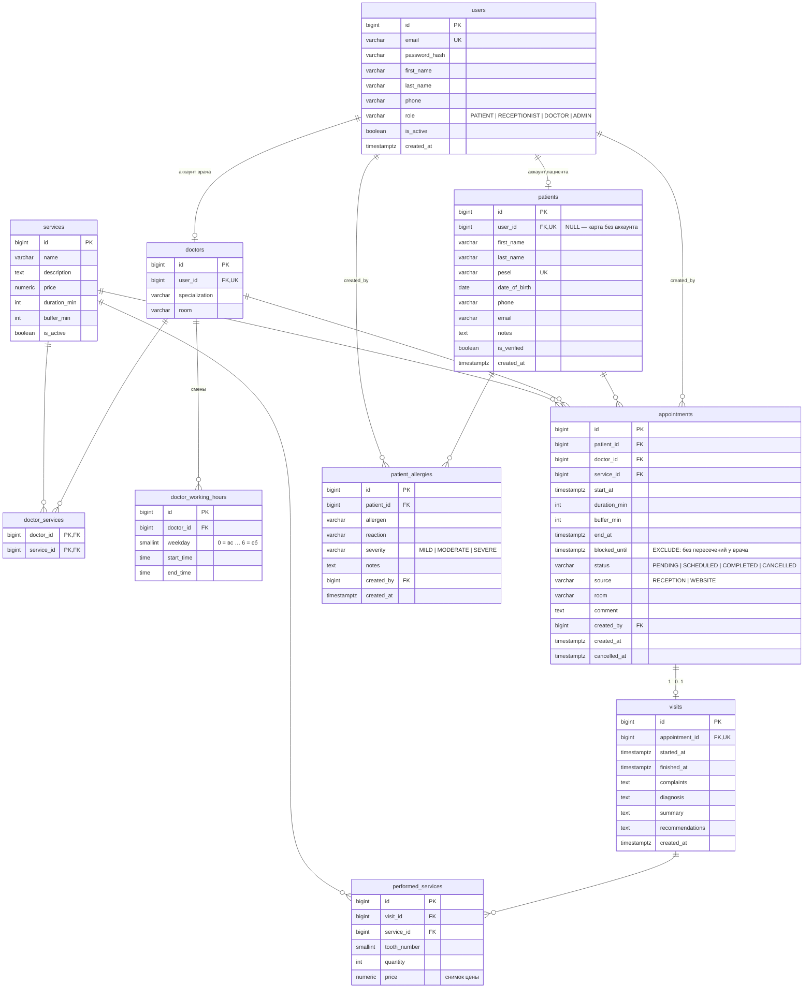

# ER-диаграмма (для презентации)

Одна БД `clinic`, таблицы поделены по сервисам-владельцам. Колонки — по реальным миграциям
(`auth_serv/alembic`, `recp_serv/db/migration` V1–V5); таблицы `user_serv` — по `docs/db_schema.md`
(сервис ещё в работе). Подробности полей — в `docs/db_schema.md`.

GitHub и VS Code (с Mermaid-плагином) рисуют диаграмму сами. Картинка для слайда:
вставить блок в https://mermaid.live → Actions → PNG/SVG.

| Сервис | Таблицы |
|---|---|
| `auth_serv` (Python) | `users` |
| `recp_serv` (Java) | `patients`, `doctors`, `services`, `doctor_services`, `doctor_working_hours`, `appointments` |
| `user_serv` (Python) | `visits`, `performed_services`, `patient_allergies` |
